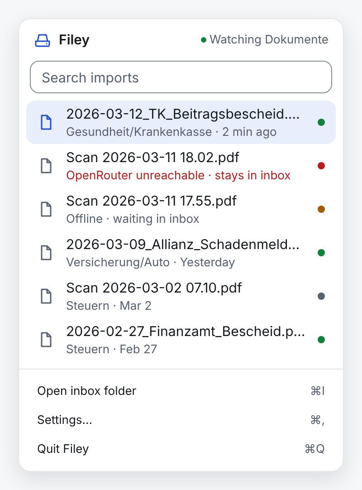
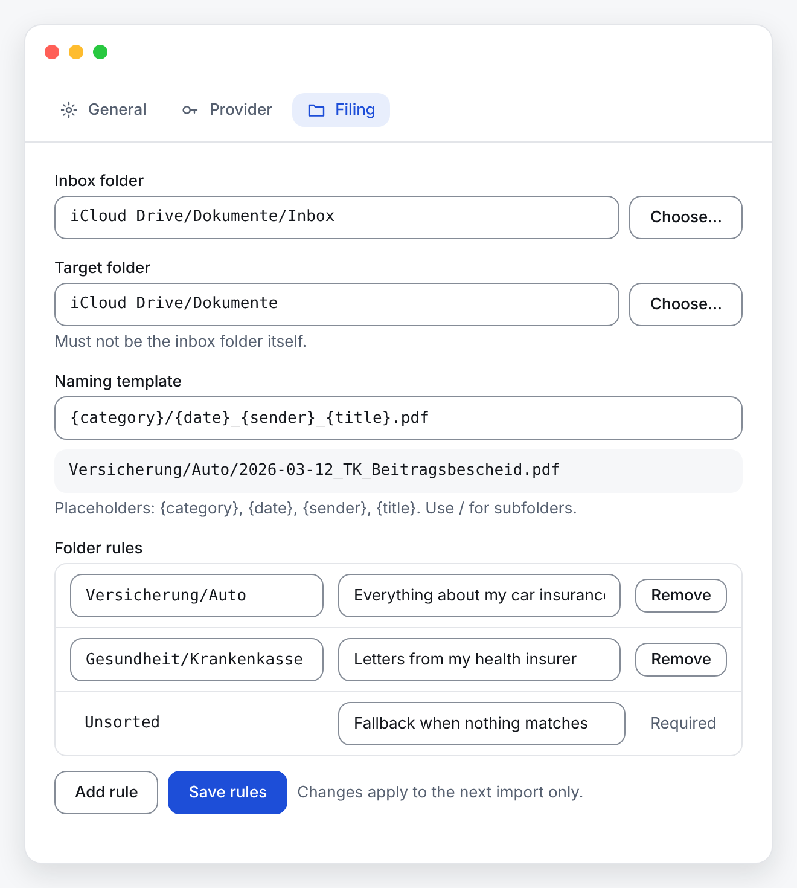
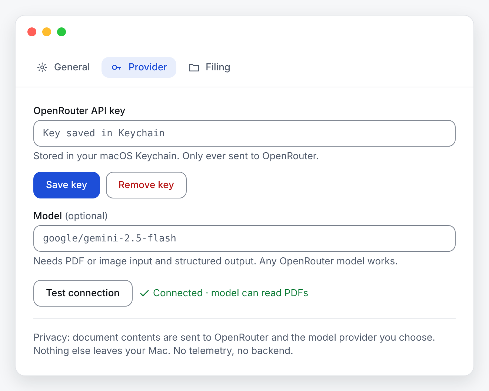

<p align="center"></p>

# Filey

*Scan it. Filed.*

[](https://github.com/FlrnDml/filey/actions/workflows/ci.yml)
[](LICENSE)
[](https://github.com/FlrnDml/filey/releases/latest)


> **Early software (0.x).** Filey works end to end, but features and settings can still change, and the app is not signed or
> notarized yet (see [Install](#install)). Bug reports and ideas are welcome.

Filey is a macOS menu-bar app that files your scanned letters for you. Scan a letter with your iPhone, save the PDF to an inbox folder in iCloud Drive, and Filey reads it with the AI model of your choice (through your own [OpenRouter](https://openrouter.ai) key), names it like `Health/Health insurance/2026-10-15_TK_Premium notice.pdf` and moves it into the right folder. The content of each scan is sent to OpenRouter and the model provider, nothing else leaves your Mac; see [Privacy](SECURITY.md#privacy).

```
iPhone scan ──▶ iCloud Drive inbox ──▶ Filey reads it (OpenRouter) ──▶ renamed and moved into your folder tree
```

<p align="center">
  
  
</p>

## Install

Paste this into Terminal:

```bash
curl -fsSL https://raw.githubusercontent.com/FlrnDml/filey/main/scripts/install-mac.sh | bash
```

It downloads the latest build from [GitHub Releases](https://github.com/FlrnDml/filey/releases), copies Filey to
**Applications** and opens it. Run it again to update. Filey is not signed or notarized with an Apple Developer ID yet, and
macOS blocks apps downloaded in a browser; files fetched with `curl` skip that check, so the script is the easiest way in.
It only runs what you can [read first](scripts/install-mac.sh).

**Prefer the DMG?** Download `Filey-<version>-universal.dmg` from
[GitHub Releases](https://github.com/FlrnDml/filey/releases/latest) (builds of every change on `main` are listed there as
pre-releases, for testing) and drag **Filey** to **Applications**. Because the app is not signed yet, macOS blocks the first launch:

- Open Filey once. When macOS says it cannot verify the app, click **Done** (not "Move to Trash").
- Open **System Settings → Privacy & Security**, scroll down to the message about Filey and click **Open Anyway**, then confirm with your password.
- On macOS 14 and earlier you can instead **right-click Filey in Applications → Open → Open**.

You only need to do this once per installed version.

## Requirements

- macOS (universal build for Apple Silicon and Intel).
- iCloud Drive, or any other folder you want Filey to watch.
- An [OpenRouter API key](https://openrouter.ai/keys) (`sk-or-…`). OpenRouter bills each request to your account.
- A model that can read scanned PDFs or images **and** supports structured output. The default is `google/gemini-2.5-flash`; you can type any other OpenRouter model id.

## Update

There are no automatic updates yet. Your settings, history and logs live in `~/Library` and are kept.

- **With the script:** run the install command again. It quits Filey, replaces the app in **Applications** with the newest build and opens it.
- **With the DMG:** quit Filey, open the new DMG and drag **Filey** to **Applications**, choosing **Replace**. Then repeat the "Open Anyway" steps above.

After an update, Filey may ask for your API key again (see [Known limitations](#known-limitations)).

## Features

- **Menu bar only.** No Dock icon and no main window. Click the scanner icon for the popover with your inbox and your history; right-click it for Settings…, Show logs and Quit Filey.
- **Files new PDFs automatically.** Filey watches the inbox folder (not its subfolders), waits until a file has finished syncing, downloads iCloud placeholders first, and then files the PDF.
- **Your folders, described in plain language.** Folder rules such as "Insurance/Car: everything about my car insurance" tell the model where a document belongs. It can only choose one of your folders, or `Unsorted`.
- **Naming template** with `{category}`, `{date}`, `{sender}` and `{title}`, for example `{category}/{date}_{sender}_{title}.pdf`. File names are cleaned up and never overwrite an existing file (`_2`, `_3`, …).
- **Any OpenRouter model** that can read PDFs or images and return structured output. "Test connection" checks key and model with a bundled sample scan.
- **Inbox and History.** The Inbox view lists the files still in your inbox: new, waiting, failed (with the reason and Retry) or duplicate, each with Move to Trash. The History view lists what was filed where, with search. The same scan saved twice is recognized as a duplicate (by its SHA-256 hash) and not sent again.
- **Offline-aware.** Without a connection, new scans wait in the inbox and are filed once OpenRouter is reachable again.
- **Notifications** for filed and failed imports. Clicking one reveals the file in Finder or opens the inbox.

## Setup

On first launch a small window walks you through three steps:

1. **OpenRouter API key.** Paste your key. It is stored encrypted on your Mac (see [Privacy](SECURITY.md#privacy)).
2. **Start at login.** Choose whether Filey starts when you log in.
3. **Menu bar.** The window closes and Filey keeps running in the menu bar. This step also shows where Filey expects your scans.

No folder setup is needed: on the first launch Filey creates a `Filey` folder in `iCloud Drive/Documents` with an `Inbox` folder inside it, watches `Filey/Inbox` and files into the folders next to it. If iCloud Drive is off or the folder cannot be created there, the last step says so and you choose the folders in Settings → Filing. Save your scans into the inbox (for example from the iPhone Files app or the scan feature of Notes).

**Settings** (popover → Settings…, or ⌘,):

| Tab | What you can change |
| --- | --- |
| General | Start at login, debug logging, Show logs, the Filey version |
| Provider | OpenRouter API key (save or remove), model, Test connection |
| Filing | Inbox folder, target folder, naming template (with a live preview), folder rules |

<p align="center"></p>

**Folder rules.** Each rule is a folder below the target folder (use `/` for subfolders, e.g. `Health/Health insurance`) and a description of what belongs there. The descriptions go into the prompt and the model picks the best match. `Unsorted` is the fallback for documents that match no rule and cannot be removed. Changes apply to the next import; already filed documents are not moved.

**Naming template placeholders.** Keep `.pdf` at the end; `/` creates subfolders.

| Placeholder | Value | If missing |
| --- | --- | --- |
| `{category}` | The folder chosen from your rules | `Unsorted` |
| `{date}` | The document date, `YYYY-MM-DD` | The import date |
| `{sender}` | A short sender name, at most 10 characters (e.g. "Northwind" for Northwind Health Insurance) | `Unknown` |
| `{title}` | A short title | `Untitled` |

## Known limitations

- **Run Filey on one Mac only.** The iCloud inbox syncs to every Mac signed in to your Apple Account. If Filey runs on more than one, each picks up the same scan: it is analyzed twice and the moves race.
- **You may be asked for the API key again after an update.** Because the app is not signed with a Developer ID, macOS can treat an updated Filey as a different app and refuse it access to the stored key. Filey then pauses imports and opens Settings so you can paste the key again.
- **iCloud placeholders.** With "Optimize Mac Storage", a file can exist only in iCloud. Filey asks macOS to download it and waits up to five minutes; if the download does not finish, the file is skipped (see the log) and picked up again the next time Filey starts.
- **Duplicates stay in the inbox.** A scan whose content was already filed is shown as a duplicate in the Inbox view and left where it is; move it to the Trash from there or in Finder.
- **Failed imports stay in the inbox**, untouched, with the error in the Inbox view. Fix the cause (key, model, folder) and use Retry.
- No automatic updates yet: download new versions from GitHub Releases.

## Troubleshooting

- **Show logs:** right-click the menu-bar icon → Show logs, or Settings → General → Show logs. This opens `~/Library/Logs/Filey/filey.log` in your default log viewer (usually Console). The file is rotated at 1 MB; `filey.1.log` and `filey.2.log` hold the older lines.
- **Debug logging:** Settings → General → Debug logging adds more detail to the log. Logs contain file names, hashes, status and errors, never your key or document contents.
- **Nothing happens when I save a scan:** check that the inbox folder in Settings → Filing exists and that the PDF is directly in it (subfolders are ignored), then look at the log.
- **"Test connection" fails:** the message says whether OpenRouter rejected the key, does not know the model, the model could not read the sample scan or returned no structured result, or OpenRouter could not be reached. If in doubt, try the default model.
- **"Filey is damaged and can't be opened":** the download was modified or is incomplete. Download the DMG again from GitHub Releases.

## Contributing and security

Want to report a bug, suggest an idea or help build Filey? See [CONTRIBUTING.md](CONTRIBUTING.md). Report security problems privately as described in [SECURITY.md](SECURITY.md).

Filey is an independent project. It is not affiliated with, endorsed by or sponsored by Apple, OpenRouter or Google. Apple, macOS, iCloud, iPhone and Finder are trademarks of Apple Inc.; OpenRouter and Google are the names of their respective owners. They are used here only to say what Filey works with. Filey is released under the [MIT License](LICENSE).
