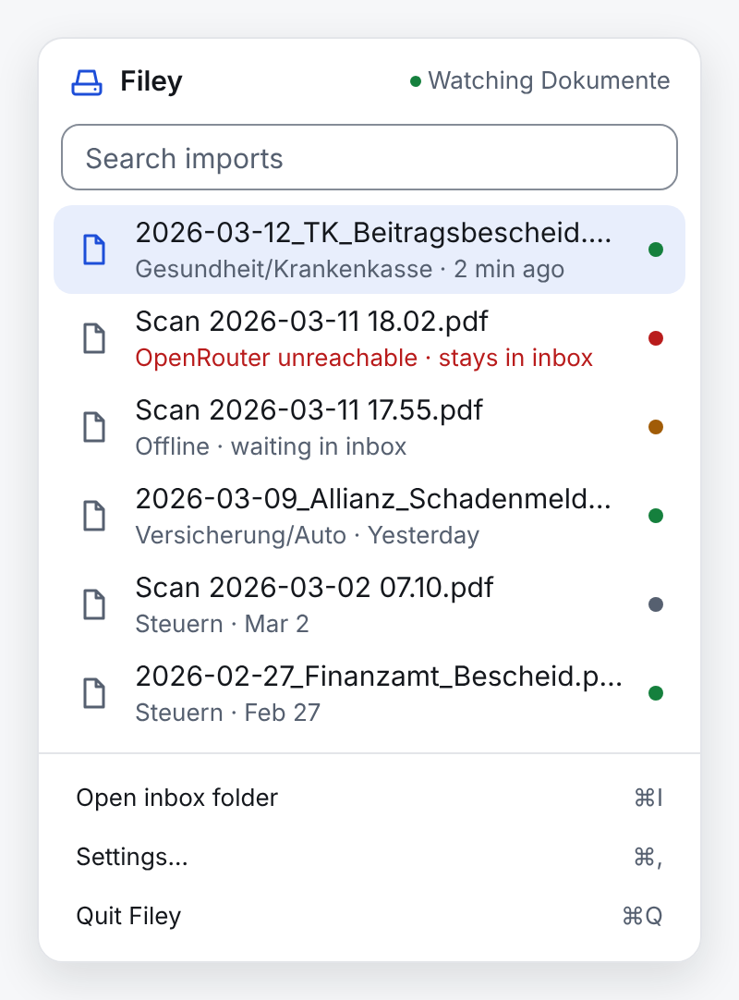
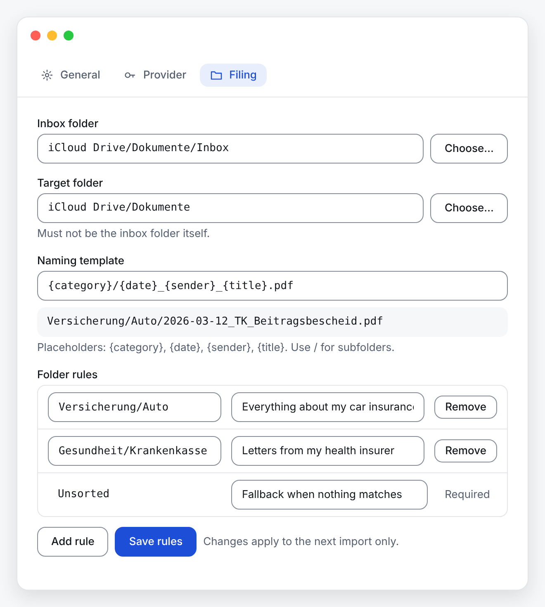
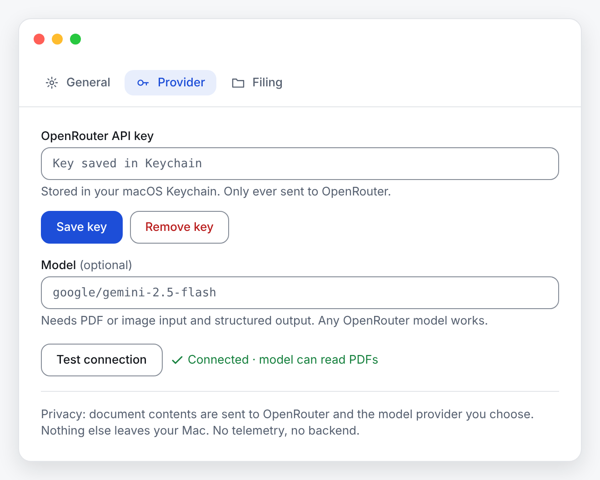

<p align="center"></p>

# Filey

*Scan it. Filed.*

[](https://github.com/FlrnDml/filey/actions/workflows/ci.yml)
[](LICENSE)
[](https://github.com/FlrnDml/filey/releases/latest)


> **Early software (0.x).** Filey works end to end, but features and settings can still change, and the app is not signed or
> notarized yet (see [Install](#install)). Bug reports and ideas are welcome.

Filey is a macOS menu-bar app that files your scanned letters for you: 
1. Scan a letter with your iPhone
2. Save the PDF to an inbox folder in iCloud Drive
3. Filey reads it with an AI model, either **on your Mac with [Ollama](https://ollama.com)** (free, nothing leaves your Mac) or in the cloud through your own [OpenRouter](https://openrouter.ai) key, names it like `Health/Health insurance/2026-10-15_TK_Premium notice.pdf` and moves it into the right folder. 

With Ollama your documents never leave your Mac. With OpenRouter the content of each scan is sent to OpenRouter and the model provider, and nothing else leaves your Mac; see [Privacy](SECURITY.md#privacy).

```
iPhone scan ──▶ iCloud Drive inbox ──▶ Filey reads it (Ollama or OpenRouter) ──▶ renamed and moved into your folder tree
```

<p align="center">
  
  
</p>

## Install

Paste this into Terminal:

```bash
curl -fsSL https://raw.githubusercontent.com/FlrnDml/filey/main/scripts/install-mac.sh | bash
```

It downloads the latest build from [GitHub Releases](https://github.com/FlrnDml/filey/releases), copies Filey to
**Applications** and opens it. Run it again to update. Filey is not signed or notarized with an Apple Developer ID yet, and
macOS blocks apps downloaded in a browser; files fetched with `curl` skip that check, so the script is the easiest way in.
It only runs what you can [read first](scripts/install-mac.sh).

**Prefer the DMG?** Download `Filey-<version>-universal.dmg` from
[GitHub Releases](https://github.com/FlrnDml/filey/releases/latest) (builds of every change on `main` are listed there as
pre-releases, for testing) and drag **Filey** to **Applications**. Because the app is not signed yet, macOS blocks the first launch:

- Open Filey once. When macOS says it cannot verify the app, click **Done** (not "Move to Trash").
- Open **System Settings → Privacy & Security**, scroll down to the message about Filey and click **Open Anyway**, then confirm with your password.
- On macOS 14 and earlier you can instead **right-click Filey in Applications → Open → Open**.

You only need to do this once per installed version.

## Requirements

- macOS (universal build for Apple Silicon and Intel).
- iCloud Drive, or any other folder you want Filey to watch.
- **One of these two ways to run the AI:**
  - **Ollama on your Mac (free, private).** Install [Ollama](https://ollama.com/download) and let Filey download a model for you. You need an Apple Silicon Mac (M1 or newer) with **16 GB of memory** and about **6 GB of free disk space** for the recommended model, `qwen2.5vl:7b`. Filing one document takes a while, typically a few seconds per page up to a minute, because the model runs on your Mac; a Mac with 8 GB is too small for it.
  - **OpenRouter (cloud).** An [OpenRouter API key](https://openrouter.ai/keys) (`sk-or-…`). OpenRouter bills each request to your account. The default model is `google/gemini-2.5-flash`; you can type any other OpenRouter model id.
- Either way, the model must read scanned documents (PDF or image input) **and** support structured output. "Test connection" checks that.

## Features

- **Menu bar only.** No Dock icon and no main window. Click the scanner icon for the popover with your inbox and your history; right-click it for more.
- **Files new PDFs automatically.** Filey watches the inbox folder (not its subfolders), waits until a file has finished syncing, downloads iCloud placeholders first, and then files the PDF.
- **Your folders, described in plain language.** Folder rules such as "Insurance/Car: everything about my car insurance" tell the model where a document belongs. It can only choose one of your folders, or `Unsorted`.
- **Start from the folders you already have.** Scan the target folder to see it as a tree with the rule of each folder, and turn your existing folders into folder rules with **Map folders**.
- **Fix old file names.** **Check names** lists the PDFs whose names do not follow your naming template; Filey proposes a new name for the files you pick and renames each one only after you accept it, in its own folder.
- **Naming template** with `{category}`, `{date}`, `{sender}` and `{title}`, for example `{category}/{date}_{sender}_{title}.pdf`. File names are cleaned up and never overwrite an existing file (`_2`, `_3`, …).
- **Local or cloud AI, your choice.** Run a model on your Mac with Ollama, or use any OpenRouter model that can read PDFs or images and return structured output. "Test connection" checks provider, model and scan reading with a bundled sample scan. With Ollama, Filey reads the first three pages of each document as images.
- **Inbox and History.** The Inbox view lists the files still in your inbox: new, waiting, failed (with the reason and Retry) or duplicate, each with Move to Trash. The History view lists what was filed where, with search. The same scan saved twice is recognized as a duplicate (by its SHA-256 hash) and not sent again. **Clear history…** in the History view removes all entries; your filed documents stay where they are, but Filey no longer recognizes them as duplicates.
- **Offline-aware.** Without a connection (OpenRouter) or while Ollama is not running, new scans wait in the inbox and are filed once the provider answers again.
- **Notifications** for filed and failed imports. Clicking one reveals the file in Finder or opens the inbox.

## Setup

On first launch a small window walks you through three steps:

1. **Where the AI runs.** Choose **Ollama (on this Mac)** or **OpenRouter (cloud)**. For OpenRouter, paste your key; it is stored encrypted on your Mac (see [Privacy](SECURITY.md#privacy)). For Ollama, Filey shows whether Ollama is running; if not, **Get Ollama** opens the download page. Then click **Download model** to fetch the recommended model (about 6 GB, with a progress bar and a Cancel button). You can finish this step before the download is done; scans wait in the inbox until Ollama and the model are ready.
2. **Start at login.** Choose whether Filey starts when you log in.
3. **Menu bar.** The window closes and Filey keeps running in the menu bar. This step also shows where Filey expects your scans.

No folder setup is needed: on the first launch Filey creates a `Filey` folder in `iCloud Drive/Documents` with an `Inbox` folder inside it, watches `Filey/Inbox` and files into the folders next to it. 

If iCloud Drive is off or the folder cannot be created there, the last step says so and you choose the folders in Settings → Filing. Save your scans into the inbox (for example from the iPhone Files app or the scan feature of Notes).

**Settings** (popover → Settings…, or ⌘,):

| Tab | What you can change |
| --- | --- |
| General | Start at login, debug logging, Show logs, the Filey version |
| Provider | OpenRouter or Ollama; for OpenRouter the API key (save or remove) and model; for Ollama the model (with Download model), the address of Ollama and Test connection |
| Filing | The target folder as a tree (Scan, Rescan, Map folders), inbox folder, target folder, naming template (with a live preview), folder rules |
| Names | Check names, Suggest names and the rename queue (Accept, Skip, Accept all) |

<p align="center"></p>

**Using Ollama.**

- Install Ollama from [ollama.com/download](https://ollama.com/download) and start it (it runs in the menu bar). Filey finds it at `http://localhost:11434`; you only change the address in Settings → Provider if you run Ollama on another port. The address must point to your own Mac.
- The recommended model is `qwen2.5vl:7b`. You can type any other Ollama model that understands images (for example `gemma3:4b`, which is smaller and faster but less accurate) and download it with **Download model**.
- **Test connection** tells you whether Ollama is running, whether the model is installed, and whether it can read the bundled sample scan. A model that cannot read images fails this test.
- The first scan after a pause is slower, because Ollama loads the model into memory first. Filey waits up to five minutes for an answer.
- Ollama keeps the model in memory for a few minutes after the last scan, then frees it.

**Folder rules.** Each rule is a folder below the target folder (use `/` for subfolders, e.g. `Health/Health insurance`) and a description of what belongs there. The descriptions go into the prompt and the model picks the best match. `Unsorted` is the fallback for documents that match no rule and cannot be removed. Changes apply to the next import; already filed documents are not moved.

**Use an existing folder.** If you already sort your documents into folders (for example `iCloud Drive/Documents`), make that folder the target folder in Settings → Filing and click **Scan**. Filey reads the folder and file names (not the files) and shows the folders as a tree: each one either has a rule (its description is shown), has **No rule** yet, or is a rule whose folder Filey creates on the next filing. Click **Add rule** or **Edit rule** on a folder to describe it; the rule is saved right away.

**Map folders** proposes a rule for every folder without one, with a description made from the folder name; folders that hold files are selected. Change the descriptions, or click **Suggest descriptions** to let your AI provider write them from the folder names and up to five file names per folder, then **Add rules**. Nothing is sent before you click Suggest descriptions. After you change folders in Finder, click **Rescan**. The inbox folder and hidden files are skipped; a scan stops after 6 folder levels or 5,000 files and folders.

**Rename existing files.** In Settings → Names, **Check names** scans the target folder again and lists the PDFs whose names do not follow the naming template (only the file-name part is checked, the folder is not). Select up to 20 files and click **Suggest names**: Filey reads each document like an import (with OpenRouter it is sent and billed like one) and proposes a name built from your template. Then **Accept**, **Skip** or **Accept all**. A file is renamed in its own folder and never moved; if the name is taken it gets `_2`. Files that Filey filed keep their place in the History, so duplicates are still recognized.

**Naming template placeholders.** Keep `.pdf` at the end; `/` creates subfolders.

| Placeholder | Value | If missing |
| --- | --- | --- |
| `{category}` | The folder chosen from your rules | `Unsorted` |
| `{date}` | The document date, `YYYY-MM-DD` | The import date |
| `{sender}` | A short sender name, at most 10 characters (e.g. "Northwind" for Northwind Health Insurance) | `Unknown` |
| `{title}` | A short title | `Untitled` |

## Known limitations

- **Run Filey on one Mac only.** The iCloud inbox syncs to every Mac signed in to your Apple Account. If Filey runs on more than one, each picks up the same scan: it is analyzed twice and the moves race.
- **Local models are slower and less exact than cloud models.** A 7B model on a 16 GB Mac can mix up sender and recipient or misread small print. Check the History after the first few documents, and use OpenRouter with a larger model if you need more accuracy.
- **With Ollama, only the first three pages are read** (at a reduced resolution). Date, sender and title are almost always on the first pages, but a long document whose first pages say nothing useful can end up in `Unsorted`.
- **You may be asked for the API key again after an update (OpenRouter).** Because the app is not signed with a Developer ID, macOS can treat an updated Filey as a different app and refuse it access to the stored key. Filey then pauses imports and opens Settings so you can paste the key again.
- **Proposed names can be wrong.** Suggest names reads each document again and can pick a wrong date, sender or title, just like an import. Check every name before you accept it. If a document has no date, the proposal uses today's date.
- **The folder tree does not update by itself.** Click **Rescan** after you add, rename or remove folders in Finder. Renaming files while iCloud is still syncing them can fail; Filey then shows the error and you check names again.
- **iCloud placeholders.** With "Optimize Mac Storage", a file can exist only in iCloud. Filey asks macOS to download it and waits up to five minutes; if the download does not finish, the file is skipped (see the log) and picked up again the next time Filey starts.

## Updates

There are no automatic updates yet. Your settings, history and logs live in `~/Library` and are kept.

- **With the script:** run the install command again. It quits Filey, replaces the app in **Applications** with the newest build and opens it.
- **With the DMG:** quit Filey, open the new DMG and drag **Filey** to **Applications**, choosing **Replace**. Then repeat the "Open Anyway" steps above.

After an update, Filey may ask for your API key again (see [Known limitations](#known-limitations)).

## Troubleshooting

- **Show logs:** right-click the menu-bar icon → Show logs, or Settings → General → Show logs. This opens `~/Library/Logs/Filey/filey.log` in your default log viewer (usually Console). The file is rotated at 1 MB; `filey.1.log` and `filey.2.log` hold the older lines.
- **Debug logging:** Settings → General → Debug logging adds more detail to the log. Logs contain file names, hashes, status and errors, never your key or document contents.
- **"Test connection" fails:** the message says whether OpenRouter rejected the key, whether Ollama is not running or the model is not installed, whether the model does not exist, could not read the sample scan or returned no structured result, or whether the provider could not be reached. If in doubt, try the default model.
- **Scans stay in the inbox as "Waiting for Ollama".** Ollama is not running. Start the Ollama app; Filey checks every 30 seconds and files the waiting scans in order.
