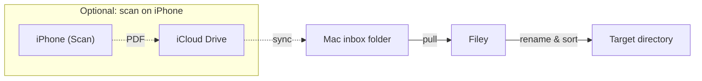
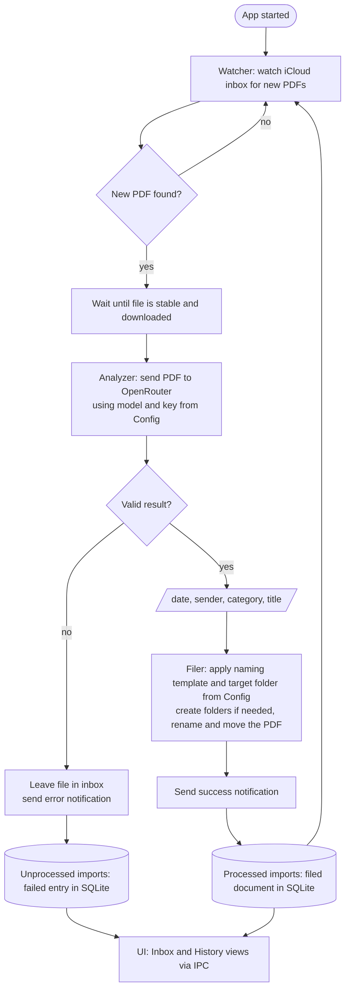

# Filey – Architecture Documentation (arc42)

## 1. Introduction and Goals

### 1.1 Requirements Overview

Filey is a macOS menu-bar app that automatically files scanned PDFs. It watches an iCloud inbox folder, classifies each new PDF with an AI model, renames it according to a configurable naming scheme and moves it into the correct sub-folder structure.

Tagline: *"Scan it. Filed."* 

**Core flow**

1. The user scans a new document (e.g. a letter from the health insurer) with their iPhone.
2. The user saves the scan (PDF) into an iCloud folder (e.g. "Documents/Inbox").
3. The app detects it in the background and files it correctly (naming scheme and sub-folder).

**Functional requirements**

| ID | Requirement |
|----|-------------|
| F1 | Works out of the box with a sensible default ruleset |
| F2 | Naming scheme is customizable (template, e.g. `{category}/{date}_{sender}_{title}.pdf`) |
| F3 | Inbox and target directories are customizable |
| F4 | BYOK: user brings their own OpenRouter API key (OpenRouter is the only supported provider) with minimal configuration |
| F5 | Local first: configuration, history and files stay on the user's machine; no backend |
| F6 | Duplicate scans are not filed again: a file whose content was already filed (and that document still exists) stays in the inbox, the Inbox view shows it as a duplicate of the earlier document, and the user is notified, so the same document does not end up filed many times |
| F7 | App shows a history of the filed documents (processed imports) |
| F8 | App shows the files still in the inbox (unprocessed imports: new, waiting, failed or duplicate) in a separate Inbox view, where failed ones can be retried and any can be moved to the Trash |

**Non-functional requirements**

| ID | Requirement |
|----|-------------|
| N1 | Built with TypeScript on Electron |
| N2 | macOS app |
| N3 | Runs in the background (at login or user-started), menu-bar only |

### 1.2 Quality Goals

| Priority | Quality goal | Motivation |
|----------|--------------|------------|
| 1 | Data safety / privacy: no calls to anything besides the provider the user selected for their API key | Documents contain sensitive (health, financial) data |
| 2 | Simple onboarding (paste an API key and optionally a model) | Needed for a first external download |
| 3 | Model freedom | Users choose any OpenRouter model |
| 4 | Extensibility | New providers should be easy to add later |

### 1.3 Project Goals and Stakeholders

**Project goals:** build the MVP covering the full flow → publish on GitHub as open source.

| Role | Expectation |
|------|-------------|
| End user (private person with paper mail) | Scan, forget, find it later in a clean folder structure |
| API Provider | Called via its official API under the user's own key |

---

## 2. Architecture Constraints

| Area | Constraint |
|------|-----------|
| Tech / UI | TypeScript and React, bundled with Webpack through Electron Forge |
| Design | The frontend follows the Filey design system in `docs/design-system/` (tokens, components, content rules); colours, type, spacing and radii come only from its tokens |
| Language | English only for now: app UI, code, comments, documentation, issues and commits. The documents themselves can be in any language (mainly official mail, letters and invoices) |
| Platform | macOS only |
| Persistence – documents | iCloud Drive holds the PDF documents |
| Persistence – application data | One local SQLite database (via `node:sqlite`, accessed with Drizzle ORM) in the app data directory stores the settings, the processed and the unprocessed imports |
| Convention | Provider-specific code only in one factory (`createModel`) |

---

## 3. Context and Scope

### 3.1 Business Context



| Partner | Input | Output |
|---------|-------|--------|
| User (iPhone) | Scanned PDF into iCloud folder | – |
| iCloud Drive | Syncs file to the Mac | Receives the filed document |
| OpenRouter (external) | PDF + prompt – document content leaves the machine | `{date, sender, category, title}` |
| User (Mac UI) | Settings, key, templates, retry or trash inbox files | Inbox and history, status |

### 3.2 Technical Context

| Interface | Technology |
|-----------|-----------|
| File system | Node `fs`, `chokidar` (polling) |
| AI API | HTTPS via Vercel AI SDK to OpenRouter |
| Local database | SQLite file `filey.db` in the app data directory (`app.getPath('userData')`), opened with Node's built-in `node:sqlite` module and queried through Drizzle ORM (`drizzle-orm/node-sqlite`); holds settings, processed and unprocessed imports; accessed only from the main process (§8 "Data storage and migrations") |
| Secrets | Electron `safeStorage` (Keychain) |
| UI ↔ Main | IPC via preload script |
| Autostart | `app.setLoginItemSettings` |
| Notifications | Electron `Notification` (macOS Notification Center) |
| Logging | Log file in `app.getPath('logs')` (`~/Library/Logs/Filey`) |

---

## 4. Solution Strategy

| Goal | Approach |
|------|----------|
| Fast MVP | Electron + TypeScript + React; Electron Forge scaffold |
| Robust watching | `chokidar` with `usePolling` and stability check (`awaitWriteFinish`) instead of relying on FSEvents; only the inbox itself, no subfolders |
| Classification | No own OCR: PDF goes straight to a model that reads PDFs/images; structured JSON via Zod schema (`generateObject`) |
| AI provider | • Start with OpenRouter as the only provider<br>• Simple interface: the user pastes an API key and enters the model by hand; "Test connection" verifies it<br>• Vercel AI SDK (`ai`) behind one factory `createModel({apiKey, model})`, so provider-specific code stays in one place<br>• Designed to be extended later (further providers, richer setup such as model lists), so the settings and the factory must not hard-wire OpenRouter |
| Local first | One local SQLite database for settings and imports; no backend |

---

## 5. Building Block View

### 5.1 Level 1 – Whitebox Overall System



| Building block | Process | Responsibility |
|----------------|---------|---------------|
| Watcher | Main | `chokidar` on the iCloud inbox (`usePolling`, `awaitWriteFinish`, `depth: 0` – subfolders are not watched); handles iCloud placeholders |
| Analyzer | Main | Sends PDF to selected OpenRouter model; `generateObject` + Zod → `{date, sender, category, title}`; `buildContent(pdf)` |
| Filer | Main | Fills template (with fallbacks for missing values), sanitizes, creates target folders, resolves collisions (`_2`), `fs.rename` |
| Imports | Main + UI | Unprocessed imports (files in the inbox) and processed imports (filed documents) in the SQLite database (§5.2); shown in the popover's Inbox and History views via IPC/preload |
| Config | Main + UI | Model, inbox path, target path, naming template, folder rules; stored in the SQLite database (the API key itself is kept in the Keychain) |
| Onboarding | Main + UI | Pasted API key, model name (default prefilled), connection test with a sample scan |
| Notifier | Main | macOS notifications for filed and failed imports |
| Logger | Main | Local log file for troubleshooting; opened from the tray |
| Tray | Main | Menu-bar icon, no Dock icon, autostart. Clicking the icon opens the popover; its menu offers Settings…, Show logs and Quit |
| UI | Renderer | React renderer with two surfaces: the menu-bar popover (Inbox and History views, search in the history, offline and paused state, quick actions) and a Settings window with the tabs General, Provider and Filing; plus the first-launch window (§6.4) |

### 5.2 Import Data Handling

There are two kinds of imports, each in its own table:

1. **Unprocessed imports** (`unprocessed_imports`): files that are still in the inbox, whether new, waiting, failed or duplicate.
2. **Processed imports** (`processed_imports`): documents that were filed and are now in the target directory.

A successful import moves an entry from the first table to the second in one transaction.

#### 5.2.1 Unprocessed imports

- There is one entry per file in the inbox, identified by its path; it also stores the content hash for the duplicate check.
- An entry has one of three states:
  1. **Pending:** new, about to be processed or waiting for the connection (§6.7). While Filey analyzes it, the UI shows it as "Working".
  2. **Failed:** processing failed (§6.5). The file stays in the inbox; the user can retry it or move it to the Trash.
  3. **Duplicate:** the content was already filed and that document still exists (§6.8). The entry links to the processed import; the user moves the extra copy to the Trash.
- The entries follow the inbox folder. When a file leaves the inbox (deleted or moved in Finder, or moved to the Trash from the popover), its entry is removed. Entries of files that left the inbox while Filey was not running are removed after the watcher's first scan of the inbox at start.
- "Delete" in the UI always means Move to Trash (`shell.trashItem`), so it can be undone.

#### 5.2.2 Processed imports

Processed imports are kept for the history and the duplicate check:

1. Their metadata is known: sender, category, title, document date, the filed path and the model used.
2. Their content hash allows the duplicate check.
3. Whether a filed document still exists is only checked when a new file with the same hash is duplicate-checked (§6.8). If the document no longer exists, its entry is removed from the history and the new file is imported normally. There is no check of all documents at app start.

#### 5.2.3 Popover views

The popover has two views, switched with a segmented control (⌘1 / ⌘2):

1. **Inbox:** the unprocessed imports, with their state, Retry, Show in Finder, Show original (duplicates) and Move to Trash. A badge on the tab counts the failed and duplicate entries. The popover opens on this view when the inbox has entries.
2. **History:** the processed imports with search; Return reveals the filed document in Finder. The popover opens on this view when the inbox is empty.

### 5.3 Filing: Analysis and Folder Rules

Filing is split into two steps: the AI reads the document and returns structured metadata, then the Filer turns that metadata into a path.

**Libraries**

| Package | Purpose |
|---------|---------|
| `ai` (Vercel AI SDK) | Provider-independent API; `generateObject` returns typed, validated output |
| `@openrouter/ai-sdk-provider` | OpenRouter provider for the AI SDK; the only provider-specific package |
| `zod` | Schema of the expected result; used by `generateObject` for validation |

`createModel({apiKey, model})` is the single place that builds the OpenRouter model from the settings. `buildContent(pdf)` passes the PDF as a `file` part (`application/pdf`); there is no own OCR. Models without native PDF support are parsed by OpenRouter.

**Analysis flow**

1. Read the settings (key, model) and the user's folder rules from the database.
2. Build the prompt: instructions + the user's folder rules + the PDF.
3. Call `generateObject` with the schema below; the SDK validates the response.
4. Return the result to the Filer; an invalid result counts as a failed import (file stays in the inbox).

**Result schema**

```ts
const DocumentInfo = z.object({
  date: z.string().nullable(),          // document date (YYYY-MM-DD); null if none is found
  sender: z.string().nullable(),        // short sender name, at most 10 characters; null if unknown
  title: z.string().nullable(),         // short title; null if none can be derived
  category: z.enum([...folderNames]),   // one of the configured folders, built at runtime
});
```

**Missing values and the sender length**

| Field | Rule |
|-------|------|
| `date` | No date found → the date of the import (today), `YYYY-MM-DD` |
| `sender` | No sender found → `Unknown`. At most 10 characters: the prompt asks the model for a short, recognizable version of a longer name (e.g. "Northwind Health Insurance" → "Northwind", "Contoso Insurance Group" → "Contoso"); the Filer cuts anything longer to 10 characters as a safety net |
| `title` | No title found → `Untitled` |
| `category` | No matching rule → fallback folder `Unsorted` |

Known classification pitfalls: sender vs. recipient, letter date vs. deadline date (see §11).

**Folder rules (user's domain knowledge)**

The user describes in the settings which kind of document belongs in which folder, in plain language, for example:

| Folder | Description |
|--------|-------------|
| `Insurance/Car` | Everything about my car insurance, including contract, invoices and claims |
| `Health/Health insurance` | Letters from my health insurer |

How it works:

- The rules are stored in the SQLite database together with the other settings.
- On each import the rules are inserted into the prompt as a list of folders with their descriptions. The AI decides itself which description fits the document best; there is no keyword matching.
- The `category` field of the schema is restricted to the configured folder names (`z.enum`), so the AI can only choose an existing folder. A fallback folder (e.g. `Unsorted`) is part of the list for documents that match no rule.
- The Filer fills the naming template (e.g. `{category}/{date}_{sender}_{title}.pdf`) with the result (missing values replaced as above), sanitizes it, creates missing folders and moves the file.
- Editing the rules changes the behaviour of the next import; already filed documents are not touched.

---

## 6. Runtime View

### 6.1 Scenario: Import a scanned document

1. File appears directly in the inbox (subfolders are ignored); watcher detects it.
2. Wait until size and mtime are stable. If it is an iCloud placeholder, force the download first (read access or `brctl download`).
3. Compute the SHA-256 hash of the file content and look it up in the processed imports. A file whose hash was already filed, and whose filed document still exists, is a duplicate: it is not sent to OpenRouter again, it stays in the inbox, the user is notified and the Inbox view shows it as a duplicate of the earlier import, see §6.8. Otherwise the file is recorded as a pending unprocessed import.
4. If OpenRouter cannot be reached, the import waits, see §6.7.
5. `buildContent` + `generateObject` return the structured metadata.
6. File name is sanitized (illegal characters, NFC normalization, length limits, collisions `_2`).
7. Target folder is created and the file moved; in one transaction the processed import is written (with the file's hash) and the unprocessed import removed.
8. A macOS notification reports the success (e.g. "Filed: 2026-10-15_TK_Invoice.pdf → Health/Health insurance"); clicking it reveals the file in Finder.
9. On error (invalid key, invalid result, file cannot be moved) the import fails, see §6.5.

### 6.2 Scenario: Onboarding and model setup

1. The user pastes an OpenRouter API key (`sk-or-…`) into the settings; the key is stored in the Keychain.
2. The model field is prefilled with a default model name (`google/gemini-2.5-flash`). The user keeps it or types any other OpenRouter model name by hand; there is no model list.
3. "Test connection" runs the real analysis on a sample scan bundled with the app: an image-only PDF of a fictitious letter with a known sender and date. This checks in one step that the key works, the model exists, the model can read scanned documents (OCR via PDF or image input) and it returns structured output.
4. The test passes if the model returns a valid result whose sender and date match the sample. Otherwise a clear message names the problem (invalid key, unknown model, model cannot read scans, no structured output), and the user is warned before saving that model.

### 6.3 Scenario: App start

1. Login item or manual start; the app shows a tray icon, no Dock icon.
2. The database is opened and migrated if needed (§8 "Data storage and migrations"); the settings are loaded and the watcher is started.
3. After the watcher's first scan of the inbox, unprocessed imports whose file is no longer in the inbox are removed. Filed documents are not checked at start (§5.2.2).

### 6.4 Scenario: Initial app start

1. First launch: onboarding has not been completed yet, so a small first-launch window opens with three steps.
2. Step 1 asks for the OpenRouter API key (stored in the Keychain). Model, inbox, target folder and folder rules start with the defaults and can be changed later in the Settings window.
3. Step 2 asks whether Filey should start automatically when the Mac starts. The choice is applied with `app.setLoginItemSettings` and stored in the settings.
4. Step 3 explains that Filey now lives in the menu bar: the window closes, the tray icon appears, there is no Dock icon, and the app keeps running in the background watching the inbox.
5. Afterwards the tray icon opens the popover (Inbox and History views, §5.2.3); Settings… opens the Settings window.

### 6.5 Scenario: Import fails

1. An import step fails (invalid key, invalid result, file cannot be moved). Being offline is not a failure, see §6.7.
2. The file stays in the inbox, untouched.
3. The unprocessed import of the file gets the state "failed" and the error message.
4. A macOS error notification is sent (e.g. "Could not file Scan_2026-10-15.pdf: invalid result from the model"); clicking it opens the popover on the Inbox view.
5. The Inbox view shows the failed entry with its error; the user can retry it or move the file to the Trash. A failed file is not retried automatically, also not after a restart.

### 6.6 Scenario: Stored API key cannot be read

1. On app start or before an import, the stored API key cannot be decrypted with `safeStorage` (e.g. the unsigned app counts as a different app after an update, see §11 risk 6).
2. Imports are paused; no file is sent or moved.
3. The app asks the user for the API key again: the settings window opens with a short explanation and the key field.
4. After the key is saved (and optionally verified with "Test connection"), the watcher resumes and pending files are imported.

### 6.7 Scenario: Offline mode

1. The Mac has no network connection, OpenRouter cannot be reached, or the Mac wakes from sleep before the network is back.
2. Filey switches to offline mode: new PDFs are still detected, but they are queued instead of sent; nothing is moved and no import counts as failed.
3. Queued files stay pending and appear in the Inbox view as "Waiting for the connection"; the tray icon and menu show that Filey is offline. No error notification is sent per file.
4. Filey checks the connection periodically and on network or wake events (Electron `net.isOnline()`, `powerMonitor` `resume`).
5. Once OpenRouter is reachable again, Filey leaves offline mode and imports the queued files one after another.

### 6.8 Scenario: Duplicate scan

1. A file appears in the inbox whose SHA-256 hash matches a processed import (e.g. the same letter was scanned twice).
2. Filey checks that the earlier document still exists at the path it was filed to. If it was deleted or moved away since, that processed import is removed from the history, and the new file is not a duplicate and is imported normally (§6.1): the history entry alone does not count.
3. If the earlier document exists, the new file is a duplicate. It is not sent to OpenRouter and not moved; it stays in the inbox, untouched.
4. The unprocessed import of the file gets the state "duplicate", linked to the processed import. Seeing the same file again (e.g. after a restart) adds no further entry and no further notification.
5. A macOS notification tells the user that the file is a duplicate and stays in the inbox (e.g. "Duplicate: Scan_2026-10-16.pdf is already filed as 2026-10-15_TK_Invoice.pdf"); clicking it reveals the earlier document in Finder.
6. The Inbox view shows the entry in the warning colour as "Duplicate of <filed name>", with "Show original" (reveals the earlier document in Finder) and "Move to Trash". Once the extra copy leaves the inbox, the entry disappears.

---

## 7. Deployment View

- Electron desktop app, local on the user's Mac; no server component.
- Universal build (arm64 + x64) with Electron Forge (`--arch=universal`), DMG via `@electron-forge/maker-dmg`.
- Distribution via GitHub Releases (downloadable DMG), published with `@electron-forge/publisher-github`.
- Notarization (Apple Developer account) is planned for the future; until then the app is unsigned and Gatekeeper warns on first launch.
- Idle footprint as a menu-bar app: roughly 150–300 MB RAM (Tauri would be leaner, but was not chosen).
- Data: one SQLite database (`filey.db`: settings, processed and unprocessed imports) in the app data directory; secrets in Keychain; documents in iCloud folders.
- Database migrations are part of the app bundle (§8 "Data storage and migrations"); no separate migration step at install.

```
User's Mac
 ├─ Filey (Electron: main + renderer)
 ├─ iCloud Drive folders (inbox, target)
 ├─ Keychain (API keys)
        └─ (cloud) OpenRouter
```

---

## 8. Cross-cutting Concepts

**AI provider (BYOK)**

- OpenRouter is the only provider for now, accessed via `@openrouter/ai-sdk-provider`; the user brings their own API key.
- The user pastes the key and types the model name by hand (a default is prefilled); "Test connection" verifies both with a sample scan (§6.2).
- The key is stored in the Keychain (`safeStorage`) and is only used for requests to OpenRouter.
- The chosen model must be able to read scanned PDFs, since there is no own OCR: it needs PDF or image (vision) input. Scans are usually image-only PDFs, so a text-only model is not sufficient.
- The model must support structured output, because the result is requested as a schema (`generateObject`).
- The model should handle official mail in any language well and have a context window large enough for multi-page documents.
- Models without native PDF support work as well: OpenRouter then parses the PDF before it reaches the model.
- Provider-specific code stays behind `createModel`, so further providers can be added later.

**Secrets:** API key stored via `safeStorage` / Keychain. If the stored key cannot be decrypted (e.g. after an update of the unsigned app), the app must ask the user for the key again; it never fails silently (§6.6).

**File names:** NFC normalization (APFS returns NFD), sanitizing `/` and `:`, length limits, collisions resolved with `_2`.

**Loop protection:** the target folder must not be the inbox itself. The inbox is watched without subfolders, so filed documents in a target tree below the inbox are not picked up again.

**iCloud placeholders:** files "optimized" by macOS must be downloaded before reading.

**Privacy:** document contents (including health data) go to OpenRouter and the underlying model provider. The README states this plainly. No telemetry, no backend.

**Process separation:** all I/O and AI calls in the main process; renderer only through preload/IPC.

**Import identity:** a processed import is identified by the SHA-256 hash of the file content, so the same scan saved twice is recognized as a duplicate, as long as the earlier filed document still exists (§6.8). An unprocessed import is identified by its path in the inbox (one entry per file) and also stores the hash; a retry belongs to the same entry.

**Offline mode:** without a connection to OpenRouter, imports are queued, not failed, and resume automatically (§6.7).

**Error handling:** failed imports remain in the inbox, are shown in the Inbox view with their error and trigger a macOS error notification (§6.5).

**Notifications:** every filed import, every failed import and every newly detected duplicate sends a macOS notification. Clicking a success notification reveals the file in Finder; clicking an error notification opens the popover on the Inbox view; clicking a duplicate notification reveals the earlier document in Finder (§6.8). Offline mode does not send a notification per file (§6.7).

**Logging:** Filey writes a local, size-limited log file to `~/Library/Logs/Filey` (watcher events, import steps, errors with details). The tray menu has "Show logs", and a "Debug logging" setting adds more detail. Logs stay local and never contain the API key or document contents; only file names, hashes, status and errors.

**Data storage and migrations:** every new app version must open the database of every earlier version without losing data.

- **Access:** the main process opens `filey.db` with `node:sqlite` and queries it through Drizzle ORM (`drizzle-orm/node-sqlite`, synchronous). The schema is defined once in TypeScript (`src/core/db/schema.ts`); the typed tables in `src/core/db/repositories.ts` are the only code that runs queries.
- **Creating a migration (development):** change the schema, then run `npm run db:generate`. `drizzle-kit` writes a SQL migration to `drizzle/<timestamp>_<name>/`, and a script bundles all migrations into `src/core/db/migrations.generated.ts`, so the app needs no migration files at runtime. Both are committed; a test fails if the bundle and `drizzle/` disagree. Data that has to be moved or converted is written as SQL into the generated migration (e.g. `INSERT … SELECT`) before it is committed.
- **Rules:** migrations only go forward and are only ever added. A migration that was released is never edited or deleted. A change that removes or renames a column carries its data over in the same migration.
- **At start, before anything else touches the database:**
  1. If the database has applied migrations that this app does not know (it was opened by a newer version), Filey does not touch it and shows that it could not start (no downgrade).
  2. Pending migrations are applied in one transaction and recorded in the table `__drizzle_migrations`. If one fails, nothing is applied and the app does not start.
- **Tests:** the migration tests open a database of every earlier schema version with sample data, migrate it and check the data.

**Versioning:** git tags are the only version history. `package.json` has no `version` and is never changed by a release; CI stamps the version into the build (`npm version … --no-git-tag-version`, not committed), and that version is what the app reports and what names the DMG and zip. Local builds are not stamped and therefore have no version. This gives one source of truth without version-bump commits, and nothing can drift between a file and the tags.

- **Tags:** a release is the tag `vX.Y.Z`, a pre-release is `vX.Y.Z-prerelease.N`, where X.Y.Z is the next patch after the last release and N counts up from 1.
- **Pre-releases:** every push to `main` that changes more than docs becomes a pre-release, and all pre-releases are kept.
- **Releases:** a commit on `main`, by default the one of the newest pre-release, can additionally become a real release through the manual Release workflow (`bump`: patch, minor or major). It creates a draft that the maintainer edits and publishes; publishing creates the tag.
- **Edge case:** without any release tag, the first release is `0.0.1`, whatever the bump.
- **Logic and tests:** `scripts/release-version.mts`, used by `prerelease.yml` and `release.yml`.

**Language:** English only for now: UI, code, comments, documentation, issues and commits.

---

## 9. Architecture Decisions

| # | Decision | Reason | Consequences |
|---|----------|--------|--------------|
| 1 | Drizzle ORM on `node:sqlite` for the local database; migrations generated by `drizzle-kit` and bundled into the app | Typed schema and queries instead of hand-written SQL and row mapping; generated migrations; no native module (unlike `better-sqlite3`, which would need a rebuild for Electron and both architectures of the universal build); synchronous API, so the main process code stays simple. Prisma was rejected: it is made for servers (migrations through a CLI at deploy time, a separate query engine) and adds startup cost | The `node:sqlite` driver only exists in Drizzle 1.0, which is a release candidate; the version is pinned exactly (see §11 risk 9) |

## 10. Quality Requirements

## 11. Risks and Technical Debt

| # | Risk | Mitigation |
|---|------|-----------|
| 1 | **iCloud sync (biggest risk):** half-uploaded files, placeholders with "Optimize Mac Storage", unreliable FSEvents, conflicts when moving during sync | Polling, stability check, forced download, never move unstable files |
| 2 | Models can be inaccurate on official mail (sender vs. recipient, letter date vs. deadline date) | Model recommendations, golden-set tests |
| 3 | Privacy: health data sent to OpenRouter and model providers | README transparency |
| 4 | Distribution: without notarization Gatekeeper deters users | Notarization later; document the first-launch steps in the README until then |
| 5 | **Several Macs on one iCloud account:** the inbox syncs to every Mac of the user; if Filey runs on more than one, each instance picks up the same PDF, so the document is analyzed twice and the moves race (duplicates, "file not found") | Treat a file that disappears during an import as handled elsewhere, not as an error; recommend running Filey on one Mac only (README) |
| 6 | **Unsigned app loses Keychain access:** Keychain items and macOS folder permissions are bound to the code signature; an unsigned app can count as a different app after an update, so the stored API key can no longer be decrypted | The app detects this and asks the user for the API key again (§6.6); solved for good with signing/notarization |
| 7 | **PDF parsing on OpenRouter:** for models without native PDF support, OpenRouter parses the PDF first; depending on the parsing engine this costs extra per page and may send the document to a further service, against quality goal 1. No limits on file size or page count are defined | Accepted for now; recommend models with native PDF/vision input; revisit engine choice and size limits later |
| 8 | **Prompt injection:** text in a scanned document can contain instructions that steer the model (e.g. choose a certain folder or produce an odd title or sender). The impact is limited because the category must be one of the configured folders, file names are sanitized and the model has no tools | The prompt tells the model to treat the document as data and to ignore instructions inside it (best effort, not a guarantee); no further measures planned |
| 9 | **Drizzle 1.0 is a release candidate:** the `node:sqlite` driver (`drizzle-orm/node-sqlite`) is only available in Drizzle 1.0, which is not final yet; its API or migration format may still change | `drizzle-orm` and `drizzle-kit` are pinned to an exact version; the database tests cover migrations and queries; move to 1.0 when it is released |

---

## 12. Glossary and Market Context

| Term | Meaning |
|------|---------|
|      |         |
